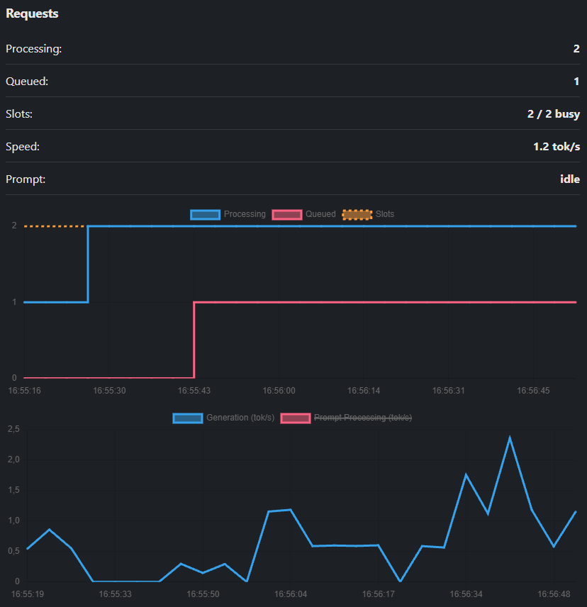

# Local AI Monitor

Lightweight, real-time web monitoring dashboard for local AI inference servers.

<div align="center" style="margin-bottom: 15px;">
    
</div>

> This project is licensed under the MIT License - see the [LICENSE](LICENSE) file for details.


## Environment Variables

| Variable                   | Default                 | Description                                                                                      |
| :------------------------- | :---------------------- | :----------------------------------------------------------------------------------------------- |
| `MONITOR_INFERENCE_ENGINE` | `llamacpp`              | Inference engine type (currently supported: `llamacpp`).                                         |
| `MONITOR_ENGINE_URL`       | `http://localhost:8080` | URL of your inference engine instance.                                                           |
| `MONITOR_ENGINE_API_KEY`   | *(None)*                | Bearer token / API key for the inference server (if required).                                   |
| `MONITOR_HISTORY_SIZE`     | `300`                   | Number of historical data points kept in memory (300 points @ 3s interval = 15 mins of history). |

## Usage

To get live GPU metrics, container stats, and real-time inference speed, both containers should share the same Docker network. `llama.cpp` must be launched with the `--metrics` flag.

Here is a complete `docker-compose.yaml` example with NVIDIA GPU support:

```yaml
services:
  # 1. llama.cpp Server
    llama-server:
        image: ghcr.io/ggml-org/llama.cpp:server-cuda
        container_name: llama-server
        restart: unless-stopped
        networks:
            - ai-network
        ports:
            - "${LLAMA_HOST_PORT}:8080"
        environment:
            LLAMA_ARG_HOST: "0.0.0.0"
            LLAMA_ARG_PORT: "8080"
            LLAMA_ARG_ENDPOINT_METRICS: "true"
            LLAMA_ARG_MODEL: "/models/${LLAMA_ARG_MODEL}"
        volumes:
            - ${LLAMA_MODELS_DIR}:/models:ro
        healthcheck:
            test: ["CMD", "curl", "-fsS", "http://localhost:8080/health"]
            interval: 30s
            timeout: 5s
            retries: 3
            start_period: 60s
        # NVIDIA GPU Passthrough for llama.cpp
        deploy:
            resources:
                reservations:
                    devices:
                        - driver: nvidia
                            count: all
                            capabilities: [gpu]

    # 2. Local AI Monitor
    local-ai-monitor:
        image: ghcr.io/petr-chalupa/local-ai-monitor:latest
        container_name: local-ai-monitor
        restart: unless-stopped
        networks:
            - ai-network
        ports:
            - "${MONITOR_HOST_PORT}:8000"
        volumes:
            # Required for monitoring container stats
            - /var/run/docker.sock:/var/run/docker.sock:ro
        healthcheck:
            test:
                ["CMD", "python", "-c", "import urllib.request; urllib.request.urlopen('http://localhost:8080/health')"]
            interval: 30s
            timeout: 5s
            retries: 3
            start_period: 15s
        # NVIDIA GPU Passthrough for usage metrics
        deploy:
            resources:
                reservations:
                    devices:
                        - driver: nvidia
                            count: all
                            capabilities: [gpu]

networks:
  ai-network:
    name: ai-network
```

### GPU Passthrough

The example focuses on NVIDIA GPUs; however, monitoring is prepared for AMD GPUs as well. Edit your Docker Compose setup accordingly.